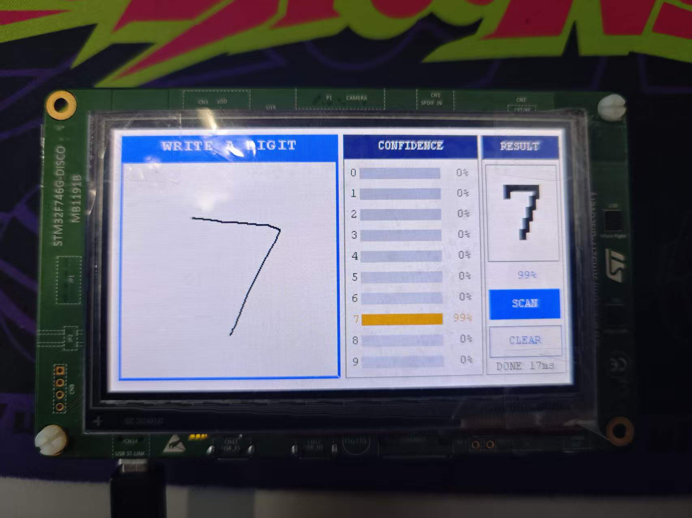
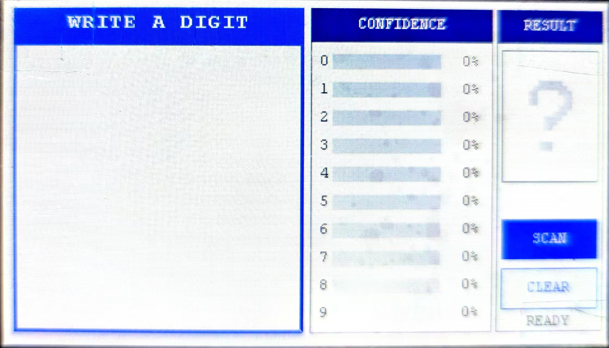

# STM32F746 手写数字识别

基于 **STM32F746G-Discovery** 的嵌入式手写数字识别 Demo：在 LCD 左侧的方框内用手指写 0–9，点 `SCAN` 后由 **Cube.AI** 生成的神经网络在片内完成推理，右侧实时显示识别结果和 0–9 的置信度分布。



*真机运行：手写 `7` → 结果 `7`、置信度 99%，状态栏显示 `DONE 17ms`。*

---

## 功能特性

- **纯屏 + 触摸交互**：不依赖按键，全部操作在 480×272 触摸屏上完成
- **手写板**：224×224 书写区，3px 笔画、Bresenham 补点，快速书写不断线
- **实时界面**：左侧手写板 + 右侧置信度面板（0–9 横条）+ 结果卡片 + `SCAN` / `CLEAR` 按钮
- **片内推理**：float32 模型，352k MACC，实测单次约 **17 ms**（状态栏显示每次耗时）
- **故障自诊断**：`HardFault` / `MemManage` / `BusFault` / `UsageFault` 会把 PC、LR、CFSR、BFAR 等信息直接打印到 LCD
- **可复现的 PC 端工具**：训练/评估脚本、界面预览渲染脚本、Cube.AI 源码注释脚本

---

## 硬件与软件环境

| 项目 | 说明 |
|---|---|
| 开发板 | STM32F746G-Discovery（STM32F746NGH6，Cortex-M7） |
| 主频 | 200 MHz（`SystemClock_Config`，HSE 25 MHz + PLL） |
| 显示屏 | RK043FN48H，480×272，LTDC + SDRAM 帧缓冲 |
| 触摸 | FT5336 电容触摸（I2C 轮询，BSP 已做 `TS_SWAP_XY`） |
| 构建 | CMake ≥ 3.20 + Ninja + `arm-none-eabi-gcc`（实测 14.3.1） |
| 模型工具 | ST Edge AI Core v4.0.1，运行时 `NetworkRuntime1201` |
| 调试 | ST-Link（VS Code 的 STM32 扩展 / STM32CubeIDE 均可） |

---

## 快速开始

```bash
# 1. 配置（选择 Debug 预设，输出到 build/Debug）
cmake --preset Debug

# 2. 编译
cmake --build --preset Debug

# 3. 烧录（任选其一）
#    - STM32CubeProgrammer 打开 build/Debug/HDR.elf
#    - VS Code 的“STM32Cube: Launch ST-Link GDB Server”调试配置直接下载
#    - ST-Link CLI: STM32_Programmer_CLI -c port=SWD -w build/Debug/HDR.elf -v -rst
```

编译产物：

| 项目 | 大小（约） | 说明 |
|---|---|---|
| Flash | 247 KB | 其中 208 KB 是模型权重（`const`，位于 `.rodata`） |
| RAM | 85 KB | 其中 49.7 KB 墨迹缓存、28 KB 激活区、3 KB 输入缓存 |

---

## 使用说明

### 界面布局



左侧是 224×224 手写区（顶部 `WRITE A DIGIT` 标题条），中间 `CONFIDENCE` 面板按 0–9 排列置信度横条（最高项橙色高亮），右侧 `RESULT` 面板显示大号结果数字、该数字的置信度，以及 `SCAN` / `CLEAR` 按钮和状态行。

1. 上电后屏幕显示界面，状态栏会先显示 `AI TEST`，随后变成 `AI 12ms` 之类的自检耗时；
2. 在左侧方框内写一个数字（0–9），状态栏显示 `WRITING`；
3. 点右侧 `SCAN`：
   - 状态栏 `SCANNING` → 推理 → 显示结果与置信度条 → `DONE 18ms`；
   - 结果卡片里的大数字即 top-1，卡片下方是它的置信度；置信度面板中最高的一项用橙色高亮。
4. 点 `CLEAR` 清空手写板、置信度和结果，回到 `READY`。

状态栏含义：

| 文本 | 含义 |
|---|---|
| `READY` | 空闲，可以书写 |
| `WRITING` | 正在落笔 |
| `SCANNING` | 推理进行中 |
| `DONE xxms` | 完成，`xx` 是本次端到端耗时 |
| `AI xxms` | 开机自检：一次全 0 输入的推理耗时 |
| `AI INIT ERR` | `AI_Init()` 失败（模型/内存问题） |
| `AI ERR -n` | 自检返回错误码：`-1` 未初始化、`-2` 运行时返回错误 |

> 界面文字只支持 ASCII（板载字库 `Font12/16/24` 只含 0x20–0x7E），不支持中文显示。

---

## 目录结构

```
HDR/
├── CMakeLists.txt            # 工程定义（用户区追加了 AI 与故障转储源文件）
├── CMakePresets.json         # Debug 预设（Ninja）
├── HDR.ld                    # 链接脚本（已移除 /DISCARD/ 以便链接 libm）
├── Src/
│   ├── main.c                # 初始化 + 主循环（触摸转发、SCAN 处理、计时）
│   ├── ui.c                  # 界面：手写板、置信度面板、结果卡片、按钮、墨迹缓存
│   ├── ai_digit.c            # 模型适配：初始化、预处理、推理、softmax
│   ├── fault_dump.c          # 异常现场打印到 LCD
│   ├── stm32f7xx_it.c        # 中断向量（异常处理器跳转到 fault_dump）
│   └── ...                   # ST BSP 例程（未使用，保留不影响）
├── Inc/
│   ├── ui.h                  # 界面 API、事件、墨迹位图尺寸
│   ├── ai_digit.h            # AI_Init / AI_Predict / AI_SelfTest
│   └── main.h                # BSP 头文件汇总
├── Drivers/
│   ├── AI/
│   │   ├── network/          # Cube.AI 生成：network.c/h、network_data.c/h、network_details.h
│   │   └── runtime/          # Cube.AI 运行时：Inc/ 头文件 + Lib/*.a
│   ├── BSP/                  # STM32746G-Discovery BSP
│   ├── CMSIS/                # CMSIS Core / Device
│   └── STM32F7xx_HAL_Driver/ # HAL
├── HDR_PC/                   # PC 端：模型、测试脚本
│   ├── mnist_tiny.onnx       # 导出的 ONNX 模型
│   ├── lenet.py              # LeNet-5 结构定义
│   ├── test_lenet.py         # 在 MNIST 测试集上评估 .pth 模型
│   └── lenet_mnist_model.pth # 预训练权重（备用）
├── tools/
│   ├── render_ui_preview.py  # 按实际坐标渲染界面预览图
│   └── annotate_network_c.py # 给 Cube.AI 生成的 network.c 重新插入中文注释
└── docs/
    ├── 运行照片.jpg          # 真机运行：手写 7 → 99%，17ms
    └── 布局.jpg              # 真机界面布局
```

---

## 模型与推理

### 网络结构（TinyMNISTNet）

| 层 | 输出 | 说明 |
|---|---|---|
| Conv2d(1, 8, 3, padding=1) + ReLU | 8×28×28 | |
| MaxPool(2×2) | 8×14×14 | |
| Conv2d(8, 16, 3, padding=1) + ReLU | 16×14×14 | |
| MaxPool(2×2) | 16×7×7 | |
| Flatten | 784 | |
| Linear(784, 64) + ReLU (+Dropout 0.25，仅训练) | 64 | |
| Linear(64, 10) | 10 | 输出 logits |

规模：**52,138 参数**（约 204 KiB），**352,426 MACC**，输入 `f32(1,1,28,28)`，输出 `f32(1,10)`，无 Softmax 层。

### 内存布局（Cube.AI 生成）

| 区域 | 大小 | 位置 |
|---|---|---|
| 权重 `g_network_weights_array` | 208,552 B | Flash（`const`，8 字节对齐） |
| 激活区（含输入/输出缓冲） | 28,084 B | 应用提供，32 字节对齐 |
| 上下文 `s_ctx` | ~64 B | 应用提供 |

激活区内部复用：`0..323` 为 scratch，`324` 起是 conv1 输出 / pool1 / fc1 输出 / 最终输出，`3460` 是 transpose 后的 784 个 float，`6596` 是 conv2/pool2 输出，`24948` 是网络输入。详见 [Drivers/AI/network/network.c](Drivers/AI/network/network.c) 顶部的注释。

### 预处理（与 MNIST 对齐）

`AI_Preprocess()` 依次做：

1. 在 223×223 墨迹位图上求**包围盒**；
2. **等比缩放到 20×20**（面积平均，得到灰度、抗锯齿）；
3. 计算**质心**，平移到 28×28 画布中心；
4. 归一化：`(v/255 - 0.1307) / 0.3081`（与训练时的 `Normalize((0.1307,),(0.3081,))` 一致）。

### 后处理

网络输出是 10 个 logits，`AI_Predict()` 里自己实现 softmax：

- 先求最大值 `m` 并从每个 logit 中减去（数值稳定，避免 `exp` 溢出）；
- `AI_Expf()` 是**纯单精度**的指数实现（位运算 + 5 阶泰勒），**不使用 libm 的 `expf`**；
- 归一化成 0–100 的整数写进 `pct[10]`，供界面画置信度条。

> 为什么要自己写 `expf`：newlib 的 `expf` 内部会使用双精度 VFP 指令（`vcvt.f64.f32`），在本板子上会触发 `UsageFault(UNDEFINSTR)`。详见下方“排错”。

---

## 关键设计说明

**1. `stai_network_set_activations()` 不可省略**

生成代码里 `g_network_activations_1` 被定义为 `NULL`，激活区必须由应用提供。并且必须在 `get_inputs()/get_outputs()` **之前**调用——输入/输出指针是在这一步按 `激活区 + 24948` / `激活区 + 324` 算出来的。

**2. 链接脚本不能丢弃 `libm` / `libgcc`**

原始 `HDR.ld` 里有：

```ld
/DISCARD/ : { libc.a ( * )  libm.a ( * )  libgcc.a ( * ) }
```

Cube.AI 运行时引用了 `expf/powf/logf/tanhf` 和 `malloc/free`，因此本工程已删除该 `/DISCARD/` 块。修改 `.ld` 后需要重新 `cmake --preset Debug`（`configure_file` 只在配置阶段复制脚本）。

**3. 不使用 Double 精度**

除了 `AI_Expf`，所有数学都保持单精度；改动代码时避免引入 `double`、`%f` 或 libm 的浮点函数，否则可能重现 `UNDEFINSTR`。

**4. MPU 与 Cache**

`MPU_Config()` 把 SDRAM（0xC0000000）设为 WT、QSPI（0x90000000）与 FMC 控制区单独放行，其余走默认映射；`CPU_CACHE_Enable()` 打开 I/D-Cache。这两处与 LTDC 显示和 Cube.AI 运行都相关，不要随意删除。

**5. Cube.AI 生成文件不要手改**

`Drivers/AI/network/*` 是生成产物，重新生成会整份覆盖（包括其中的中文注释）。注释脚本 [tools/annotate_network_c.py](tools/annotate_network_c.py) 可在重新生成后一键补回。

---

## PC 端工具

```bash
# 评估 .pth 模型在 MNIST 测试集上的准确率（需要 PyTorch + torchvision）
# Windows 下先设置，避免 OpenMP 冲突：
set KMP_DUPLICATE_LIB_OK=TRUE
python HDR_PC/test_lenet.py

# 重新渲染界面预览图（需要 Pillow）
python tools/render_ui_preview.py

# 重新生成 Cube.AI 代码后，给 network.c 补中文注释
python tools/annotate_network_c.py
```

`test_lenet.py` 会自动扫描 8 种（激活函数 × 池化方式 × 归一化）组合，找出与 checkpoint 匹配的训练配方，并输出总体准确率、逐类召回、混淆矩阵和错判样本。

---

## 排错

| 现象 | 可能原因 | 处理 |
|---|---|---|
| 启动后状态栏停在 `AI TEST` | 卡在 `stai_network_run()` 内部 | 看是否 HardFault；检查运行时库与生成代码是否同一次导出 |
| `AI INIT ERR` | `AI_Init()` 返回非 0 | 依次检查 runtime → init → set_activations → get_inputs → get_outputs |
| 点 SCAN 瞬间 `DONE 0ms` | 空画板 / 未就绪 / 推理失败 | 确认写了字；看自检是否通过 |
| 屏幕出现 `HARD FAULT` 及寄存器 | 异常 | 按 `CFSR` 分类：`UNDEFINSTR` 多为指令集/精度问题，`PRECISERR` 看 BFAR，`IACCVIOL` 看 MPU |
| 识别率明显偏低 | 预处理与训练不匹配 | 重点查归一化、极性（白字黑底）、笔画粗细、质心对齐 |

异常现场的含义见 [Src/fault_dump.c](Src/fault_dump.c) 顶部注释（CFSR 各标志位的中文说明）。

---

## 已知限制 / TODO

- 屏幕笔画约 3 px，缩到 20×20 后相对 MNIST 偏细，识别率可能低于 PC 端测试值；可在预处理里加“亮度拉满 + 3×3 膨胀”，或加粗画笔。
- 识别目前由 `SCAN` 按钮触发；`UI_TouchUpdate()` 已返回 `UI_EVT_PEN_UP`，可改为抬手自动识别。
- 界面文字仅支持 ASCII；中文需要自建字模。
- `Src/` 下仍保留 ST 的音频/摄像头/SD 等例程（未调用），可按需从 `cmake/files.cmake` 移除。
- 未做量化：若追求更小体积/更快速度，可用 Cube.AI 重新生成 int8 模型。

---

## 许可证与致谢

- 本仓库中自行编写的代码（`Src/ui.c`、`Src/ai_digit.c`、`Src/fault_dump.c`、`HDR_PC/`、`tools/`）可自由使用与修改。
- `Drivers/` 下的 HAL、CMSIS、BSP 及 Cube.AI 运行时归 STMicroelectronics 所有，遵循各自目录中的 `LICENSE.txt`。
- 模型由 PyTorch 训练并导出 ONNX，再经 ST Edge AI Core 转换为 C 代码。
